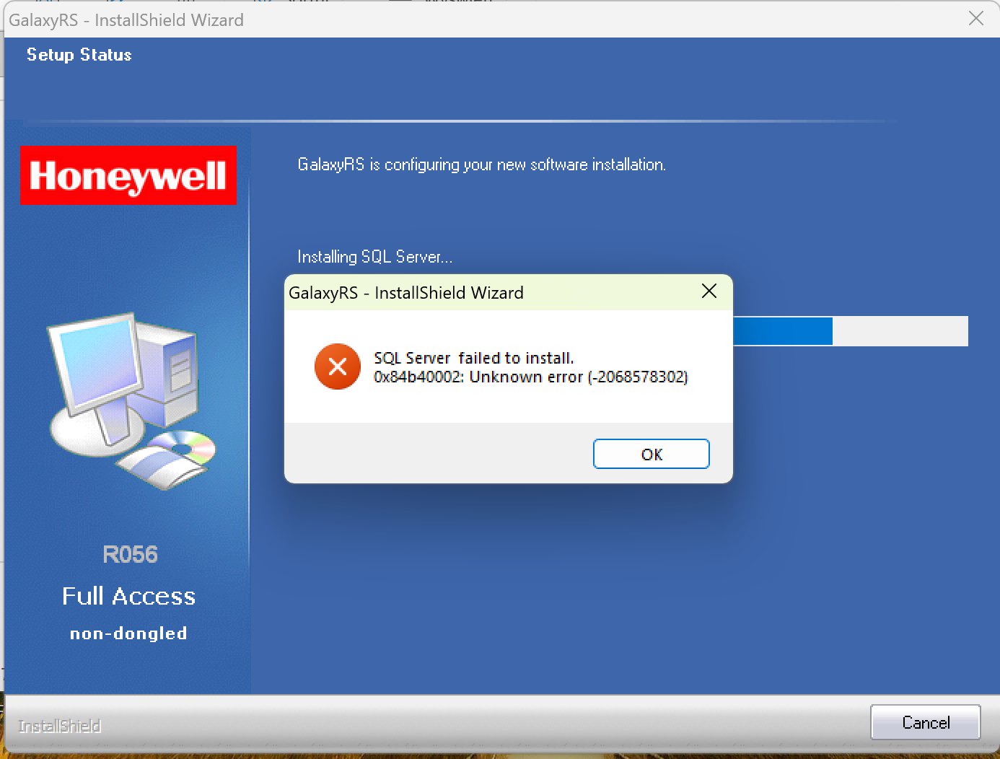
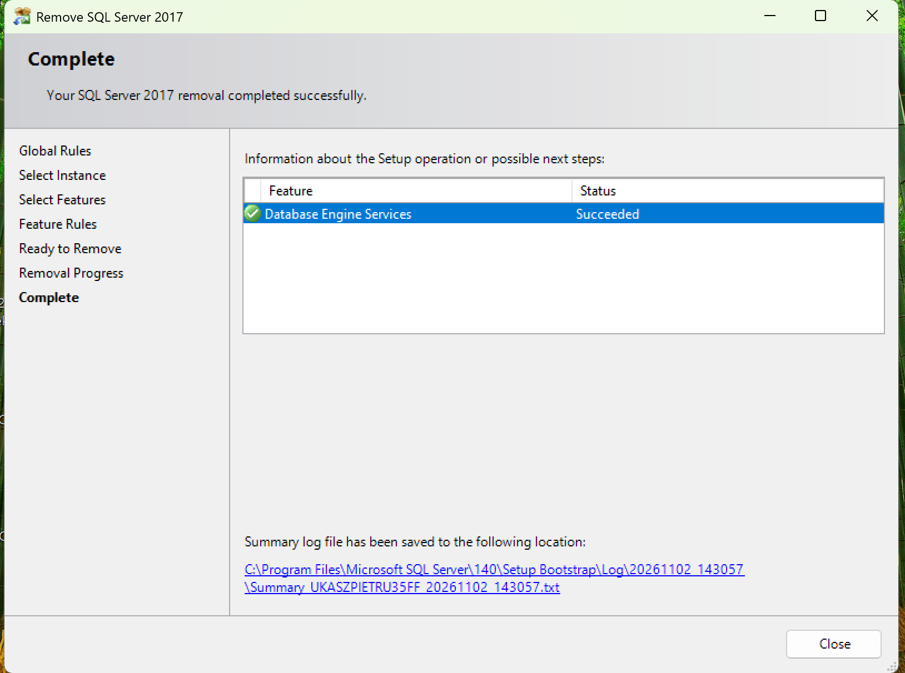
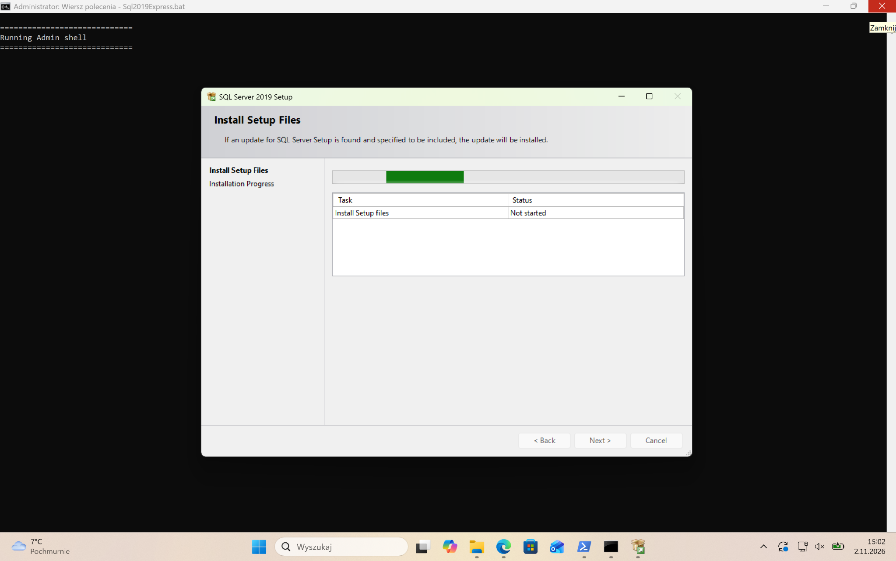
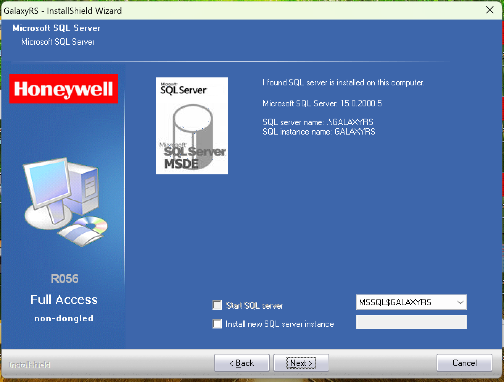
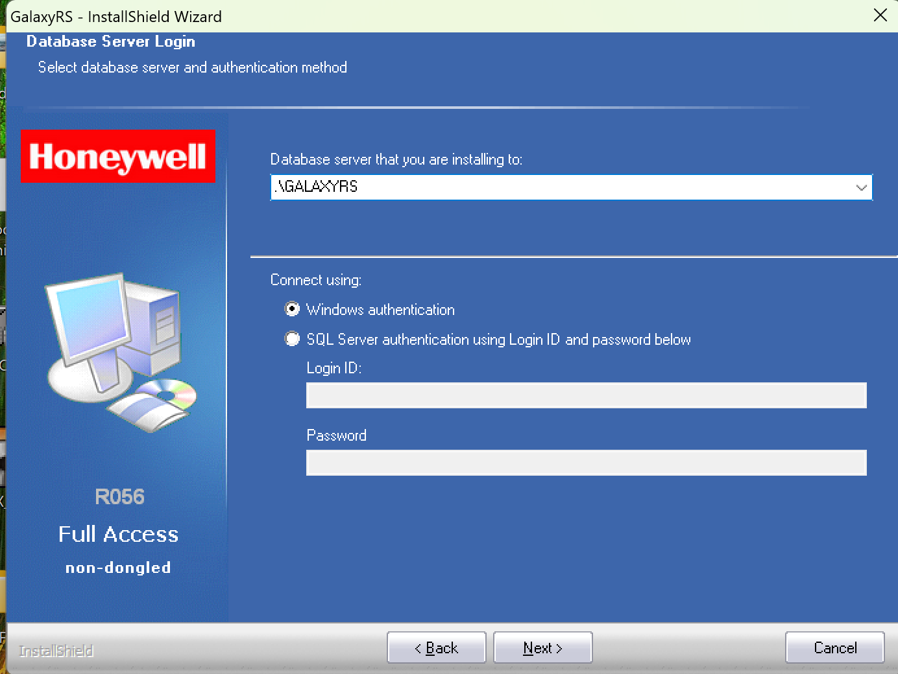
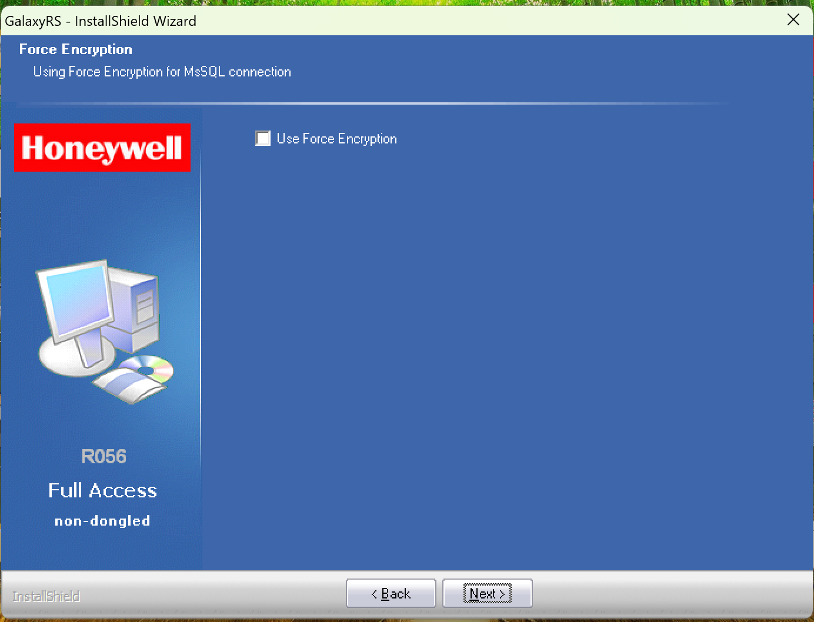
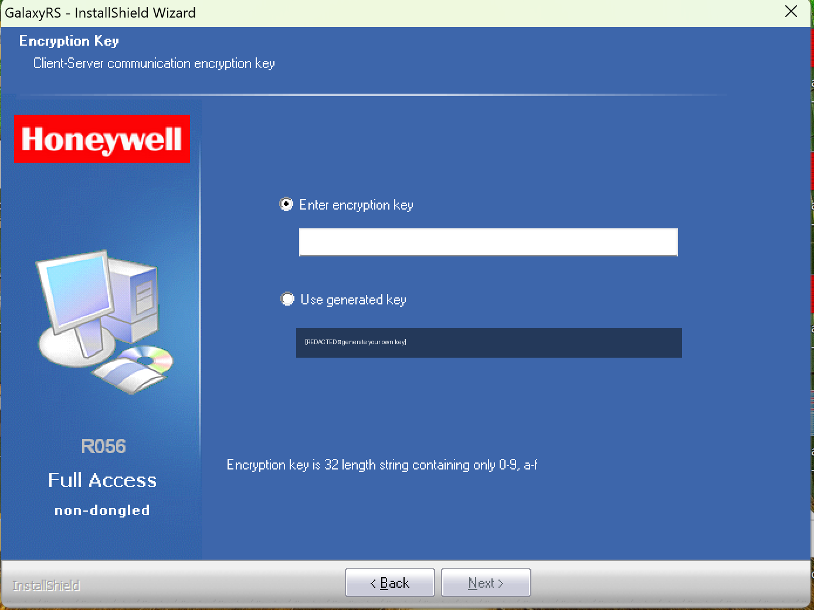
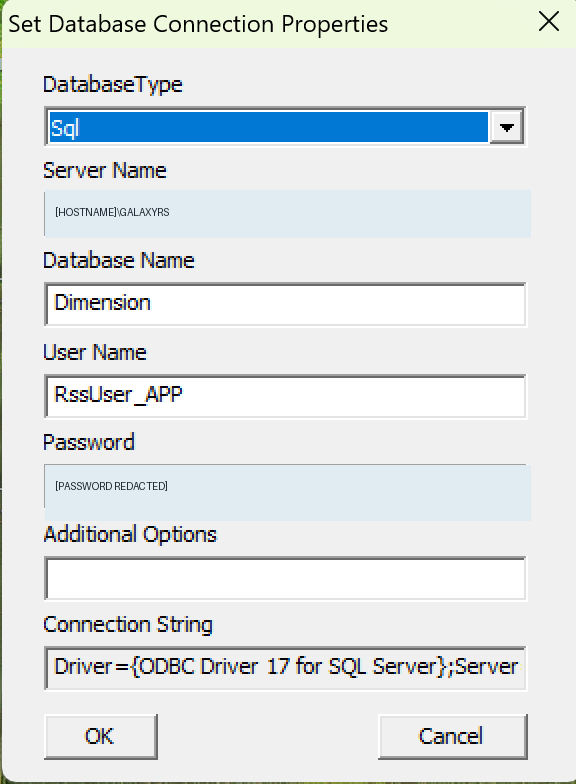

# Honeywell Galaxy Remote Servicing Suite 3.62 on Apple Silicon M2 (Parallels / Windows 11 ARM)

**A documented working installation, with troubleshooting and screenshots — 2 November 2026**

> **Status:** GalaxyRS / FrontShell launched, connected to its local SQL database, and successfully created and displayed a new Galaxy 520 site. **A real connection to a Galaxy Dimension control panel has NOT yet been tested.** This is a field report, not an officially supported Honeywell/Microsoft configuration.

## TL;DR

The GalaxyRS 3.62 installer bundled **SQL Server 2017 Express**, which failed on Windows 11 ARM running under Parallels on an Apple M2. We removed the failed `GALAXYRS` SQL 2017 instance, installed **SQL Server 2019 Express** using the community ARM64 workaround, named the instance `GALAXYRS`, then installed GalaxyRS against that existing instance. FrontShell initially kept reopening its database connection dialog; the missing setting was **SQL Server Mixed Mode authentication**. After enabling Mixed Mode and restarting SQL Server, FrontShell opened successfully.


## Test environment

| Component | Tested configuration |
|---|---|
| Host | Apple MacBook Air, M2 |
| Virtualization | Parallels Desktop |
| Guest | Windows 11 Pro ARM64, build 26200 |
| Application | Honeywell Galaxy Remote Servicing Suite **3.62**, installer branding R056 |
| Database | Microsoft SQL Server **2019 Express RTM 15.0.2000.5**, x64 via Windows ARM emulation |
| Instance | `GALAXYRS` (`MSSQL15.GALAXYRS`) |
| Application database | `Dimension` |
| Application SQL login | `RssUser_APP` |
| ODBC | ODBC Driver 17 for SQL Server (32-bit and 64-bit detected) |

**Important caveats:** SQL Server 2019 x64 on Windows ARM64 is an unsupported configuration. The community script changes registry entries and driver configuration. Make a VM backup/snapshot, use an isolated test system first, review the script, and do not expose SQL Server to untrusted networks. This guide describes what worked in one VM; it does not promise full compatibility or production suitability.

## 1. The original failure: SQL Server 2017

The GalaxyRS installer attempted to install SQL Server 2017 but displayed error `0x84B40002` (decimal `-2068578302`). The detailed message said that feature `SQL_Engine_Core_Inst` had never completed configuration and therefore could not be repaired.



We checked SQL Setup logs at:

```text
C:\Program Files\Microsoft SQL Server\140\Setup Bootstrap\Log\
```

The **earliest** failed attempt (4 March 2026) reported `0x80004005` and `Unknown error (0xe0000235)` for Database Engine Services. Subsequent attempts mainly reported `0x84B40002` — a *secondary failed-repair condition*, not proof of the original root cause. The Windows System event log also showed service termination **Event ID 7034**; the `MSSQL$GALAXYRS` service would not stay running. ARM incompatibility is a strong likely contributor, but these codes alone do not conclusively prove it.

Useful diagnostics (PowerShell as Administrator):

```powershell
Get-Service -Name 'MSSQL$GALAXYRS' -ErrorAction SilentlyContinue
Get-WinEvent -FilterHashtable @{ LogName='System'; StartTime=(Get-Date).AddHours(-2) } |
  Where-Object { $_.Id -eq 7034 -and $_.Message -match 'GALAXYRS' } |
  Select-Object TimeCreated, Id, Message
```

## 2. Remove the failed SQL Server 2017 instance

Open **Settings → Apps → Installed apps → Microsoft SQL Server 2017 (64-bit) → Uninstall**. In the SQL Server removal wizard, select **Remove**, choose the `GALAXYRS` instance, and remove **Database Engine Services**. In our case the wizard reported `Succeeded`.



We left shared SQL clients/drivers alone and did **not** delete database folders or registry entries manually. Restart Windows before the new installation. **Do not remove an instance that hosts important data without a validated backup.**

## 3. Obtain the community SQL Server 2019 Express workaround

Repository: **[jimm98y/MSSQLEXPRESS-M1-Install](https://github.com/jimm98y/MSSQLEXPRESS-M1-Install)** (also see [ebell451/MSSQL-Install-Parallels](https://github.com/ebell451/MSSQL-Install-Parallels)). The project provides an **unofficial** installation script for SQL Server 2019 Express on Windows 11 ARM64.

Find `src/Scripts/Sql2019Express.bat` in the repository. Read the script before running it. The version used here defined:

```powershell
$SqlInstance = "SQLEXPRESS"
```

We changed this to:

```powershell
$SqlInstance = "GALAXYRS"
```

That specific name matters: the GalaxyRS installer detected and reused `GALAXYRS` later. **Do not blindly copy commands from a different version of the script.** The script downloaded Microsoft's SQL Server 2019 Express package and adjusted `RsFx0600` / `RsFx0700` driver-related configuration as part of its workaround. Its first installation pass may fail as part of its scripted sequence.

### Parallels shared-folder gotcha

Launching the `.bat` from macOS Downloads produced:

```text
'\\Mac\Home\Downloads\'
CMD does not support UNC paths as current directories.
```

Copy the `.bat` into a **real Windows-local directory**, such as `C:\SQL2019`, then run it from an **elevated CMD** in that directory. This also keeps the terminal open to see errors:

```cmd
cd /d C:\SQL2019
Sql2019Express.bat
```

Do not launch a second copy while setup is active. The first attempt launched from a shared location appeared to blink and exit; running locally started the SQL Server 2019 Setup wizard.



## 4. Verify SQL Server 2019 actually works

Check the Windows service and registered instance:

```powershell
Get-Service -Name 'MSSQL$GALAXYRS'
Get-ItemProperty 'HKLM:\SOFTWARE\Microsoft\Microsoft SQL Server\Instance Names\SQL'
```

Observed output: service `MSSQL$GALAXYRS` **Running**, registry value `GALAXYRS : MSSQL15.GALAXYRS`.

The `sqlcmd` CLI was **not installed**, so we tested using built-in PowerShell/.NET:

```powershell
$c = New-Object System.Data.SqlClient.SqlConnection
$c.ConnectionString = 'Server=.\GALAXYRS;Integrated Security=True;Encrypt=False'
try {
    $c.Open()
    $q = $c.CreateCommand()
    $q.CommandText = 'SELECT @@VERSION'
    $q.ExecuteScalar()
} finally { $c.Dispose() }
```

It returned **Microsoft SQL Server 2019 (RTM) – 15.0.2000.5 (X64), Express Edition**. `Encrypt=False` was used for this **local diagnostic**; it is not a recommendation to disable encryption for networked SQL deployments.

## 5. Install GalaxyRS 3.62 using the *existing* SQL instance

Run the GalaxyRS installer. It detected SQL Server version `15.0.2000.5`, server `.\GALAXYRS`, and instance `GALAXYRS` automatically.



On that screen, keep **Start SQL server** and **Install new SQL server instance** unchecked; select the existing `MSSQL$GALAXYRS` instance. On **Database Server Login**, select `.\GALAXYRS` and **Windows authentication** for installer setup. This matched our successful Windows-integrated test.



The **Force Encryption** checkbox was left unchecked in this test because both application and SQL ran inside the same local VM. This setting is **separate** from the application's client-server encryption key; networked or production environments should review their actual TLS and certificate requirements.



On **Encryption Key**, choose **Use generated key** (or a previously configured key when restoring an existing installation). Save it securely. **The key in the screenshot below is intentionally redacted. Never publish real keys, credentials, or site secrets.** Set the requested Manager password and complete setup.



## 6. Fix the FrontShell database connection loop

Initially, FrontShell repeatedly opened **Set Database Connection Properties** after clicking OK.



The connection dialog showed database `Dimension`, SQL login `RssUser_APP`, and `ODBC Driver 17 for SQL Server`. We confirmed that **ODBC Driver 17** was already installed for **both 32-bit and 64-bit**, so a missing driver was **not** the issue:

```powershell
Get-OdbcDriver | Where-Object Name -match 'SQL Server' |
  Format-Table Name, Platform -AutoSize
```

The `Dimension` database was `ONLINE`, and the `RssUser_APP` SQL login existed and was not disabled:

```sql
SELECT name, state_desc FROM sys.databases;
SELECT name, is_disabled FROM sys.sql_logins WHERE name = 'RssUser_APP';
```

Then we checked the server's authentication mode:

```sql
SELECT SERVERPROPERTY('IsIntegratedSecurityOnly');
```

It returned **`1`**: Windows Authentication **only**. The application, however, was configured to use the `RssUser_APP` **SQL login**. We switched the SQL instance to **Mixed Mode** using an administrative Windows-integrated SQL connection:

```powershell
$c = New-Object System.Data.SqlClient.SqlConnection
$c.ConnectionString = 'Server=.\GALAXYRS;Integrated Security=True;Encrypt=False'
try {
    $c.Open()
    $q = $c.CreateCommand()
    $q.CommandText = @"
EXEC xp_instance_regwrite
N'HKEY_LOCAL_MACHINE',
N'Software\Microsoft\MSSQLServer\MSSQLServer',
N'LoginMode',
REG_DWORD,
2
"@
    [void]$q.ExecuteNonQuery()
} finally { $c.Dispose() }

Restart-Service -Name 'MSSQL$GALAXYRS'
```

This setting changes instance authentication policy; perform it only if appropriate for your environment. Keep the SQL instance off untrusted networks, use strong passwords, do not enable `sa` unnecessarily, and review SQL access controls. Running the same read-only `SERVERPROPERTY('IsIntegratedSecurityOnly')` query after restarting returned **`0`** — Mixed Mode enabled.

**Result:** FrontShell launched normally, without the repeated connection dialog.

## 7. What has actually been verified

- ✅ SQL Server 2019 Express `15.0.2000.5` service starts on Windows 11 ARM in Parallels / Apple M2.
- ✅ Local SQL connection and `SELECT @@VERSION` work.
- ✅ GalaxyRS 3.62 installer recognizes the existing SQL 2019 instance and completes.
- ✅ `Dimension` is online; SQL login `RssUser_APP` exists and is enabled.
- ✅ Mixed Mode resolves the observed FrontShell database connection loop.
- ✅ FrontShell opens and displays a newly created **Galaxy 520 / Dimension** site (version field `7.03` was manually configured or displayed; it is **not** proof of a live device connection).
- ⏳ **Not yet tested:** actual TCP/IP connection to the Galaxy panel, reading configuration, uploading changes, long-term stability, security feature compatibility.

## Troubleshooting summary

| Symptom | Investigation / resolution |
|---|---|
| SQL 2017 installer reports `0x84B40002` | Check earliest Setup Bootstrap logs. This can indicate a previously incomplete installation; it does not alone prove ARM incompatibility. |
| `MSSQL$GALAXYRS` service stops / Event ID 7034 | SQL 2017 engine did not initialize successfully. We used SQL 2019 Express ARM workaround instead. |
| BAT launched from `\\Mac\Home\Downloads` | Copy script to a local Windows folder (`C:\SQL2019`), run from elevated CMD. |
| BAT window closes quickly | Launch from an already-open elevated CMD; inspect output and SQL 2019 Setup logs in `150\Setup Bootstrap\Log`. |
| `sqlcmd` command not found | Use `.NET SqlConnection` from PowerShell, or install appropriate SQL command-line tools separately. |
| FrontShell repeats database settings | Check ODBC driver, `Dimension` online, login exists; in **this case**, SQL authentication mode was Windows-only. Enabling Mixed Mode + SQL service restart resolved it. |

## Sources, credits, and limitations

- Community installer script by [jimm98y/MSSQLEXPRESS-M1-Install](https://github.com/jimm98y/MSSQLEXPRESS-M1-Install). Credit belongs to its authors; this guide **does not redistribute or claim authorship** of the script.
- [ebell451/MSSQL-Install-Parallels](https://github.com/ebell451/MSSQL-Install-Parallels) describes Windows 11 ARM64 requirements and unsupported SQL features (including FILESTREAM) and explains that the installer initially uses Windows Authentication.
- Honeywell GalaxyRS and Microsoft SQL Server are their respective owners' products. This is an independent experience report and is **not** official vendor guidance.
- Screenshots are from one real installation, with database credentials and the client-server encryption key redacted. There may be additional sensitive metadata in your own screenshots; inspect them before publishing.
- **Security note:** do not use this unvalidated installation as the sole control/maintenance path for live security systems. Follow your organization's procedures, maintenance windows, backups, and authorization requirements.

### Suggested post title

**[Guide] Honeywell GalaxyRS 3.62 / FrontShell working on Apple Silicon M2 via Parallels + SQL Server 2019 Express (Windows 11 ARM)**

Feedback and additional real-panel test results are welcome.
